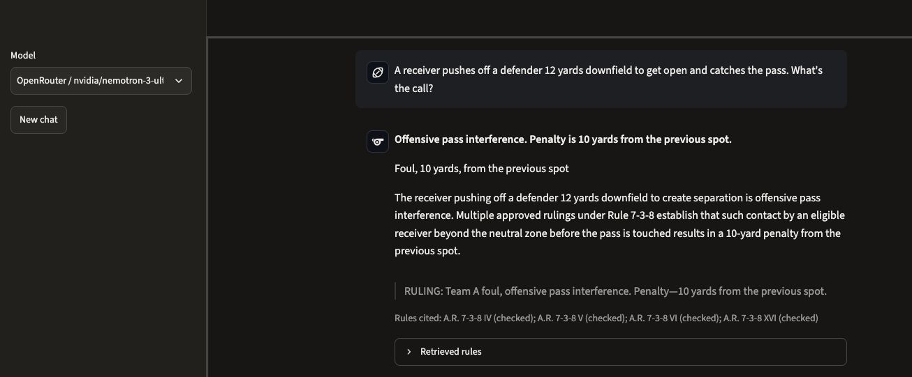

# NCAA Football Referee

AAI-530 Final Project, Group 7: Jason Justice and Timothy Hays.

Ask an NCAA football rules question or describe a play, and get a ruling that cites rule numbers from the official 2026 NCAA Football Rules and Interpretations. Work in progress.



## Setup

Works on macOS and Windows.

1. Install [uv](https://docs.astral.sh/uv/getting-started/installation/).
2. Get at least one model backend:
   - A free Groq API key: https://console.groq.com/keys (fastest), or
   - A free OpenRouter API key: https://openrouter.ai/keys, or
   - [Ollama](https://ollama.com) running locally with `ollama pull gemma3:12b` (no key needed, about 8 GB).
3. Copy `.env.example` to `.env` and add your key(s). Never commit `.env`.
4. Download the rulebook into `data/` and split it by rule number:
   ```
   uv run python -m referee.ingest
   ```
5. Start the app:
   ```
   uv run streamlit run referee/app.py
   ```

## Evaluate

Rule search only (no model calls, free):
```
uv run python eval/retrieval_eval.py
```

Rulings from the models. By default the eval uses one model per provider: Groq `openai/gpt-oss-120b`, OpenRouter `nvidia/nemotron-3-ultra-550b-a55b:free`, and Ollama `gemma3:12b`. Each question runs 3 times per model. Answers are saved to `eval/results/` as they come in, so a run stopped by a free-tier limit picks up where it left off:
```
uv run python eval/run_eval.py --split dev
uv run python eval/run_eval.py --split dev --models "Groq / openai/gpt-oss-120b"
uv run python eval/run_eval.py --split dev --summary
```

## Lint

```
uv run python lint.py
```

Runs ruff's basic checks (syntax errors, undefined names, unused imports), fixes what it can, and formats the code.

## Layout

- `referee/backends.py`: Groq, OpenRouter, and Ollama clients with retries. Only providers that are set up are offered.
- `referee/ingest.py`: downloads the official PDF (not stored in this repo) and splits it into rule chunks (like `9-1-2`) and approved-ruling chunks (like `A.R. 9-1-2`).
- `referee/retrieve.py`: keyword search (BM25) over the chunks, with a rule-number boost, typo fixes, and a football slang list.
- `referee/ruling.py`: searches the rules, adds the penalty when a rule's penalty is written elsewhere in its section, asks the model for a JSON ruling, and checks that every cited rule number was in the retrieved rules and that the quote is word for word (punctuation and list markers like "(a)" are ignored).
- `referee/prompts/`: system prompt versions.
- `referee/app.py`: the Streamlit chat app.
- `referee/terminology.json`: football slang mapped to rulebook wording. Search adds the rulebook words when a question uses the slang.
- `eval/retrieval.csv`, `eval/retrieval_eval.py`: 19 rule-search test questions and their scorer.
- `eval/scenarios.csv`: test questions with the expected ruling (foul, yards, spot, rule). `dev` questions are used to revise the prompt; `test` questions are only for the final run.
- `eval/run_eval.py`: runs the scenarios on each model and scores type, foul, yards, spot, rule cited, citation check, quote, review flag, consistency across runs, and latency. Also writes a grading sheet for human review.
- `eval/results/`: saved model answers (one JSONL file per prompt and model), plus the generated summary table and grading sheet.
- `docs/report.md`: project report, with results, limitations, ethics, and AI use.
- `docs/appendix.md`: prompt and testing appendix.
- `docs/slang_to_rulebook.md`: football slang guide.
- `docs/planning/`: the assignment spec, plan, and schedule.

## Football terminology

See [slang to rulebook wording](docs/slang_to_rulebook.md) for common player, coach and broadcaster phrases. The matching [JSON vocabulary](referee/terminology.json) is used by rule search. Special-teams descriptions use kicking team and receiving team.

## Known limitations

- A study aid, not an official ruling. Not for live games.
- Answers come only from the 6 rule sections search finds. If the right rule is not among them, the model says the rules don't cover it, or reasons from the wrong rule.
- The checks confirm that cited rules and the quote come from the retrieved text. They do not prove the reasoning is right.
- Free tiers have rate limits. Long questions can be too big for Groq's free tier.
- Questions to Groq and OpenRouter leave your machine. Use Ollama to keep them local.
- Text only, English only, NCAA rules only.

See section 8 of the [report](docs/report.md) for details.

## Timothy evaluation work

The [approved 30-development/10-final-test package](evaluation/README.md) and historical local prototype are preserved for provenance. Use the current `referee/` application for integration. [Evaluation reconciliation and grading](eval/README.md) explains how the approved cases and historical results are kept separate.
